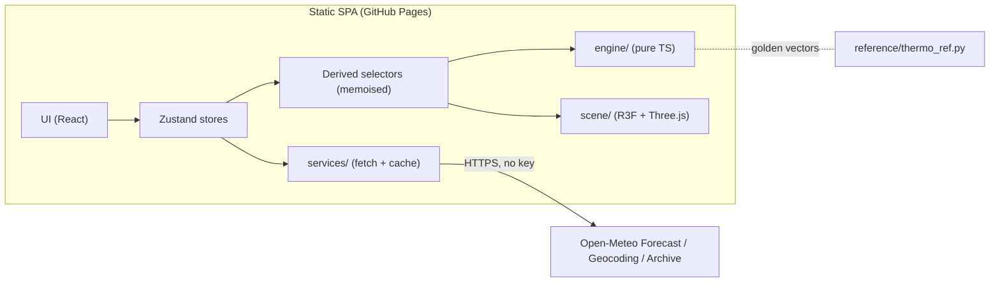
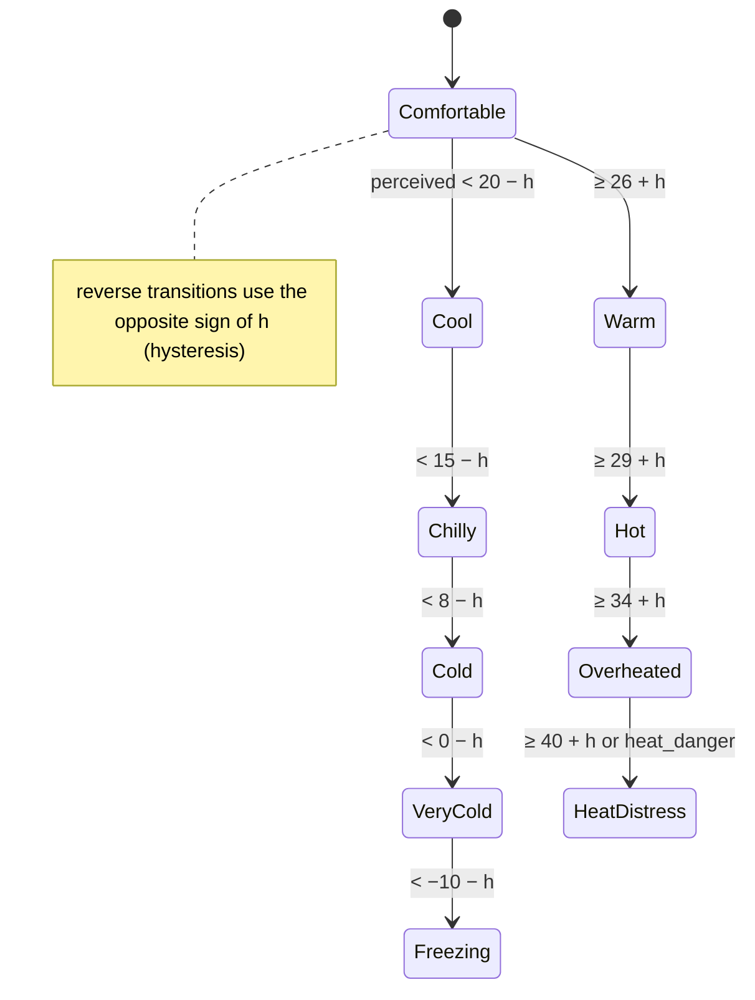

# Weather Report: Technical Design Document
**Version 1.0, engine 3.0.0** · Companion to [`PRODUCT_SPEC.md`](./PRODUCT_SPEC.md)

This is the engineering blueprint. Where this document and the reference implementation disagree, **`reference/thermo_ref.py` wins** and this document should be fixed.

**Contents**
1. Conventions
2. Architecture
3. Weather data layer
4. Thermoregulation engine
5. Clothing insulation database
6. Recommender, travel planner, packing
7. Animation state machine
8. Three.js avatar architecture
9. State management
10. UI composition and routing
11. Accessibility implementation
12. Testing strategy
13. Build, CI and deployment
14. Performance budgets
15. Implementation plan (tickets)
16. Open technical questions

---

## 1. Conventions

- **TypeScript strict** (`"strict": true`, `noUncheckedIndexedAccess`). No `any` in `src/engine`.
- **Units inside the engine are SI-ish and fixed:** °C, %, m/s (body-level air speed), W/m², kPa, clo, metres. Conversion to °F or mph happens **only in the UI layer**.
- **Engine purity:** `src/engine/**` has zero runtime dependencies, no React, no DOM, no `Date.now()`, no randomness. Same input gives the same output, bit for bit.
- **Naming:** golden-vector JSON uses `snake_case` (from Python). The TS engine uses `camelCase`; the test adapter maps between them.
- **Versioning:** `ENGINE_VERSION` (semver) is exported. Any change to a constant or equation is a minor bump and requires regenerating golden vectors from the Python reference *first*.

---

## 2. Architecture



### Repository layout
```
weather-report/
├─ CLAUDE.md                     # handoff instructions for Claude Code
├─ docs/  PRODUCT_SPEC.md  TECHNICAL_DESIGN.md
├─ reference/                    # executable spec (Python 3.11+, no deps)
│  ├─ thermo_ref.py  golden_vectors.json  example_output.txt  bands_output.txt  checks_output.txt
├─ public/
│  ├─ models/ avatar_base.glb  garments/*.glb   anims/*.glb
│  └─ textures/ zone_mask.ktx2 …
├─ src/
│  ├─ engine/        constants.ts garments.ts solar.ts wetness.ts heatBalance.ts
│  │                 perceived.ts zones.ts indices.ts states.ts evaluate.ts recommend.ts index.ts
│  ├─ data/          garments.json  weatherCodes.json  backdrops.json
│  ├─ services/      openMeteo.ts geocoding.ts climateNormals.ts solarPosition.ts cache.ts
│  ├─ state/         weatherStore.ts outfitStore.ts avatarStore.ts settingsStore.ts travelStore.ts selectors.ts
│  ├─ scene/         AvatarCanvas.tsx Avatar.tsx GarmentLayer.tsx Avatar2D.tsx
│  │                 animation/ (stateMachine.ts clips.ts)  materials/ (skinResponse.ts wetFabric.ts)
│  │                 particles/ (Breath.tsx Sweat.tsx Rain.tsx Snow.tsx)  environments/
│  ├─ ui/            components/ + routes/
│  └─ main.tsx
├─ tests/  golden/ property/ unit/ e2e/
└─ .github/workflows/ ci.yml deploy.yml
```

### Dependency rules (enforced with ESLint `import/no-restricted-paths`)
- `engine` imports nothing outside `engine` and `data/garments.json`.
- `services` may import `engine` types only.
- `scene` reads from `state/selectors`; it never calls `services`.
- `ui` never imports `three` directly (only `scene` components), so Three.js stays lazy-loaded.

### Stack
React + TypeScript + Vite · Three.js + @react-three/fiber + @react-three/drei · Zustand · Vitest + fast-check + Testing Library · Playwright. **Pin exact versions** at scaffold time (latest stable at R0) and commit the lockfile.

---

## 3. Weather data layer

### 3.1 Forecast request
```
GET https://api.open-meteo.com/v1/forecast
  ?latitude={lat}&longitude={lon}
  &current=temperature_2m,relative_humidity_2m,apparent_temperature,is_day,precipitation,rain,snowfall,
           weather_code,cloud_cover,wind_speed_10m,wind_gusts_10m,wind_direction_10m,
           shortwave_radiation_instant,direct_normal_irradiance_instant,diffuse_radiation_instant,
           uv_index,snow_depth
  &hourly=<same list as current> ,precipitation_probability
  &daily=temperature_2m_max,temperature_2m_min,precipitation_sum,precipitation_probability_max,
         uv_index_max,sunrise,sunset,wind_speed_10m_max,weather_code
  &timezone=auto&timeformat=unixtime&forecast_days=16
  &wind_speed_unit=kmh&temperature_unit=celsius&precipitation_unit=mm
```
- Use the **`_instant`** radiation variables. The plain ones are preceding-hour means and lag the sun by 30 minutes.
- `timeformat=unixtime` plus the returned `timezone` lets us do DST-correct local times client-side (Open-Meteo's ISO strings use a fixed offset).
- **Geocoding:** `https://geocoding-api.open-meteo.com/v1/search?name={q}&count=8&language={lang}`, debounced 300 ms, minimum 2 characters.
- **Climate normals (travel, > 16 days out):** `https://archive-api.open-meteo.com/v1/archive` for the same calendar window over the last 10 years, hourly temperature, humidity, wind, precipitation and radiation. Aggregate to per-day-of-trip percentiles (P25/P50/P75) **at build time of the query, client-side** (§6.2).

### 3.2 Normalised model
```ts
export interface WeatherSample {
  time: number;            // unix seconds UTC
  tAir: number;            // °C
  rh: number;              // %
  windKmh: number;         // 10 m wind speed
  gustKmh: number;
  ghi: number; dni: number; dhi: number;  // W/m² (instant)
  sunAltDeg: number;       // computed, see 3.4
  precipMmH: number;       // rain + showers + snow water equivalent
  snowfallCmH: number;
  snowDepthM: number;
  weatherCode: number;     // WMO
  isDay: boolean;
  uvIndex: number;
  apparentTemp: number;    // Open-Meteo's, display only
}
```

### 3.3 Caching and limits
- In-memory LRU (20 locations) plus `localStorage` (`wr:wx:{lat2}:{lon2}`, coordinates rounded to 2 dp), TTL **15 min** for forecast, **30 days** for climate normals.
- Show stale data immediately, then revalidate (SWR pattern). Mark it with "Updated 3 h ago" if it's older than 1 h.
- Free-tier limits: < 600/min, < 10,000/day. Never poll faster than every 15 min. One request per city covers current, hourly and daily.
- Errors: HTTP 400 has a JSON `{error, reason}`, so surface `reason` in dev and a friendly retry in prod. Network failure falls back to cache and an offline banner.
- Footer attribution: "Weather data by Open-Meteo.com (CC BY 4.0)" with a link.

### 3.4 Solar position (sun altitude)
Open-Meteo doesn't return sun altitude, so compute it from time and coordinates (NOAA simplified, accurate to about 0.5°, which is fine for SolarCal):
```
γ  = 2π/365 · (dayOfYear − 1 + (hourUTC − 12)/24)
δ  = 0.006918 − 0.399912cosγ + 0.070257sinγ − 0.006758cos2γ + 0.000907sin2γ − 0.002697cos3γ + 0.00148sin3γ
EoT(min) = 229.18 · (0.000075 + 0.001868cosγ − 0.032077sinγ − 0.014615cos2γ − 0.040849sin2γ)
trueSolarTime(min) = minutesUTC + EoT + 4·lonDeg
ha = (trueSolarTime/4 − 180)°
sin(alt) = sin(lat)sin(δ) + cos(lat)cos(δ)cos(ha)
```
Unit-test against 3 known values (equinox noon at the equator ≈ 90°, Toronto June-solstice noon ≈ 69.8°, Toronto December-solstice noon ≈ 22.9°).

---

## 4. Thermoregulation engine

### 4.1 Model in one paragraph
For each of 6 body zones we compute steady-state dry heat loss (convection + radiation through the clothing) and maximum evaporative capacity (through the clothing's vapour resistance), using ISO 7730 / ISO 9920 / ASHRAE Fundamentals ch. 9 relations. Summed over zones and combined with metabolic heat and respiration, these give a **thermal load**. On the cold side the load is a heat deficit; on the warm side we use **required skin wettedness** (load ÷ evaporative capacity), so heavy clothing in heat correctly makes you hotter. The load is mapped to a temperature by asking: *at what air temperature would the reference person carry the same load?* That temperature is the **perceived temperature**. Zones get their own felt temperature using the same idea, with skin-tissue resistance, which makes bare skin agree with the official Wind Chill.

### 4.2 Public API
```ts
export type ZoneId = 'head'|'torso'|'arms'|'hands'|'legs'|'feet';
export type Activity = 'standing'|'strolling'|'walking';
export interface Context { activity: Activity; shade: boolean; umbrella: boolean; personalOffset: number }
export interface EngineWeather { tAir:number; rh:number; windKmh:number; ghi:number; dni:number; dhi:number;
                                 sunAlt:number; precipMmH:number; snowDepthM:number }
export type ComfortState = 'dangerous_heat'|'overheated'|'hot'|'warm'|'comfortable'|'cool'|'chilly'|'cold'|'very_cold'|'freezing';
export type ZoneState = 'hot'|'warm'|'ok'|'cool'|'cold'|'freezing'|'numb';
export type Flag = 'heat_strain'|'heat_danger'|'frostbite_risk'|'hypothermia_risk'|'suggest_rain_gear';
export type FrostbiteRisk = 'high'|'very_high'|'severe'|'extreme'|null;

export interface ZoneResult { clo:number; wetness:number; tFelt:number; state:ZoneState; exposed:boolean; frostbite:FrostbiteRisk }
export interface ComfortResult {
  perceived:number; state:ComfortState; index:number; loadWm2:number; requiredWettedness:number;
  cloTotal:number; cloEffective:number; vRel:number; tMrt:number; wetArea:number;
  humidex:number; windChill:number; zones:Record<ZoneId,ZoneResult>; flags:Flag[];
  explain: Explanation;          // TS-only, see 4.12 (not in golden vectors)
}
export function evaluate(w:EngineWeather, outfit:GarmentId[], ctx:Context, cfg?:Partial<EngineConfig>):ComfortResult;
export function recommend(w:EngineWeather, ctx:Context, cfg?:Partial<EngineConfig>):Recommendation;
```
`EngineConfig` holds every constant in 4.3 so the playtest/calibration UI (§15, T-24) can tweak them live.

### 4.3 Constants
| Name | Value | Source / rationale |
|---|---|---|
| Zone areas (head, torso, arms, hands, legs, feet) | 0.09, 0.37, 0.13, 0.05, 0.29, 0.07 | Rule-of-nines style split, sums to 1 |
| `CLO` | 0.155 m²K/W | Definition |
| `LR` (Lewis relation) | 16.5 K/kPa | ASHRAE Fundamentals |
| `H_R` | 4.7 W/m²K | Linearised radiation, typical clothed body |
| `SIGMA_SKIN_DIFF` | 0.06 | Minimum skin wettedness (diffusion) |
| `WIND_HEIGHT_FACTOR` | 0.67 | 10 m to ~1.1 m wind (log profile) |
| `V_MIN` | 0.5 m/s | Outdoors is never still (cf. UTCI floor) |
| `REF_V` | 0.5 m/s | Reference person: light air |
| `REF_V_ZONE` | 1.34 m/s | 4.8 km/h, the ECCC wind-chill reference walking speed |
| `REF_RH`, `REF_MET`, `REF_OUTFIT` | 50%, 1.2 met, t_shirt + jeans + socks + sneakers | Reference person |
| `R_TISSUE` | 0.09 m²K/W | Face-tissue resistance in the ECCC wind-chill model (≈0.091) |
| `VASO_START / GAIN / MAX` | 17°C / 0.3 / 5°C | Hand and foot vasoconstriction (heuristic) |
| `WET_SATURATION_MM_H` | 2.0 | Rate that soaks unprotected fabric (heuristic) |
| `SNOW_WETTING_FACTOR` | 0.3 | Dry snow (T < −1°C) |
| `UMBRELLA_UPPER_FACTOR` | 0.2 | Precip still reaching head, torso and arms |
| `RAIN_EVAP_EFFICIENCY` | 0.3 | Share of rain-evaporation heat drawn from the body (heuristic) |
| `WIND_PENETRATION` / `_WP` | 0.4 / 0.1 at ≥ 10 m/s | Insulation loss of permeable vs windproof-covered zones (ISO 9920 order of magnitude) |
| Activity (met, walking m/s) | standing 1.2/0 · strolling 1.6/0.6 · walking 2.0/0.9 | ASHRAE 55 Table 5.2.1.2 |

### 4.4 Air speed
```
vBody = max(V_MIN, WIND_HEIGHT_FACTOR · windKmh / 3.6)
vRel  = hypot(vBody, vWalk(activity))
```
Gusts are display-only in v1.

### 4.5 Solar load: ASHRAE 55-2023 Appendix C (SolarCal), outdoor variant
```
if ghi ≤ 0 or sunAlt ≤ 0: ΔTmrt = 0
f_eff = 0.725, h_r = 6.012, α_sw = 0.67, α_lw = 0.95
f_svv = shade ? 0.5 : 1.0
f_bes = shade ? 0 : (umbrella ? 0.2 : 1.0)
albedo = snowDepthM > 0.01 ? 0.7 : 0.2
β = min(sunAlt, 90)
f_p = 0.308 · cos( β · (0.998 − β²/50000) )          // projected-area factor, standing (deg inside cos)
ERF = ( 0.5·f_eff·f_svv·(dhi + ghi·albedo) + f_p·f_eff·f_bes·dni ) · α_sw/α_lw
ΔTmrt = ERF / (f_eff · h_r)
Tmrt = tAir + ΔTmrt
```

### 4.6 Wetness
```
rate = precipMmH · (tAir < −1 ? SNOW_WETTING_FACTOR : 1)
for zone z:
  r = rate · (umbrella && z ∈ {head,torso,arms} ? UMBRELLA_UPPER_FACTOR : 1)
  shielded = ∃ garment g: g.waterproof && g.coverage[z] ≥ 0.5
  wet[z] = shielded ? 0 : min(1, r / WET_SATURATION_MM_H)
```
v1 is steady state (assumes about 30 min of exposure). Time-based soaking is backlog (§4.13).

### 4.7 Zone clothing
```
localClo(g, z) = g.clo / Σ_z' (A[z'] · g.coverage[z']) · g.coverage[z]          // redistribute whole-body clo
items = garments with coverage[z] > 0
windproof[z] = ∃ g ∈ items: g.windproof && g.coverage[z] ≥ 0.5
fWind = 1 − (windproof ? WIND_PENETRATION_WP : WIND_PENETRATION) · min(vRel, 10)/10
clo[z] = fWind · Σ localClo(g,z) · (1 − g.wetLoss · wet[z])
i_m[z] = Σ localClo / Σ (localClo / g.i_m)        // series vapour resistance; bare zone → 1.0
```

### 4.8 Heat balance (per zone, then whole body)
```
M     = met · 58.15                                   // W/m²
Tsk   = 35.7 − 0.0275 · M                             // Fanger comfort skin temperature
Pa    = rh/100 · Psat(tAir);  Psk = Psat(Tsk);   Psat(t) = 0.6108·exp(17.27t/(t+237.3)) kPa
h_c   = max( 12.1·√vRel , 2.38·|0.6·(Tsk − tAir)|^0.25 )   // ISO 7730 forced vs natural (non-iterative)
Top   = (H_R·Tmrt + h_c·tAir) / (H_R + h_c)
for each zone z:
  f_cl = 1 + 0.31·clo[z]
  R_cl = clo[z]·CLO;   R_a = 1 / (f_cl·(h_c + H_R))
  q[z] = (Tsk − Top) / (R_cl + R_a)                                           // dry loss
  Emax[z] = max(0, Psk − Pa) / ( R_cl/(i_m[z]·LR) + 1/(LR·f_cl·h_c) )
  Erain[z] = RAIN_EVAP_EFFICIENCY · wet[z] · max(0, Psat(tAir) − Pa) · LR · f_cl · h_c
Dry = Σ A[z]·q[z];  Emax = Σ A[z]·Emax[z];  Erain = Σ A[z]·Erain[z]
Resp = 0.0014·M·(34 − tAir) + 0.0173·M·(5.87 − Pa)
Edif = SIGMA_SKIN_DIFF · Emax
Load = M − Dry − Resp − Edif − Erain                 // >0 must be sweated away; <0 is a deficit
```

### 4.9 Strain index and perceived temperature
```
index(load, Emax) = load ≤ 0 ? load : 100 · load / ((1 − SIGMA_SKIN_DIFF) · Emax)
```
- **Reference table:** for T = −80…+70°C in 0.5°C steps, evaluate the heat balance for the reference person (Tmrt = T, v = REF_V, RH 50%, 1.2 met, REF_OUTFIT, dry) and store `(T, index)`. It is strictly increasing (asserted by test). Build it once at module load (301 entries, < 1 ms). It's also shipped in `golden_vectors.json → reference_table` for cross-checking.
- **Inversion:** binary search, then linear interpolation. Linear extrapolation beyond the table ends.
- `perceived = inverse(index) + personalOffset`.
- **Sanity anchor:** the reference person in reference conditions gives exactly 22.0 at 22°C (golden case E4).

Properties guaranteed (tested, §12.3): monotone in air temperature (25,056/25,056 sweep points), wind (≤ 30°C), humidity (≥ 20°C), clothing (≤ 33°C), activity, sun > shade > night, and rain.

### 4.10 Zone felt temperature
```
clo_ref[z] = Σ localClo(g, z) for g in REF_OUTFIT     // head 0, torso 0.202, arms 0.04, hands 0, legs 0.828, feet 0.571
h_c_ref = 12.1·√REF_V_ZONE
R_act = R_TISSUE + clo[z]·CLO      + 1/((1+0.31·clo[z])·(h_c + H_R))
R_ref = R_TISSUE + clo_ref[z]·CLO  + 1/((1+0.31·clo_ref[z])·(h_c_ref + H_R))
tFelt = Tsk − (Tsk − Top)·R_ref/R_act
        − 2·wet[z]                                    // wet-fabric chill (heuristic)
        − (z ∈ {hands,feet} ? min(VASO_MAX, max(0, VASO_GAIN·(VASO_START − perceived))) : 0)
        + personalOffset
exposed = clo[z] < 0.1
```
Validation: bare hands vs ECCC Wind Chill: −10°C/20 km/h → −16.2 vs −17.9; −20/30 → −30.5 vs −32.6; −30/40 → −44.8 vs −47.5.

### 4.11 States, flags, official indices
**Comfort state** (perceived °C, lower bounds): dangerous_heat ≥ 40, overheated ≥ 34, hot ≥ 29, warm ≥ 26, comfortable ≥ 20, cool ≥ 15, chilly ≥ 8, cold ≥ 0, very_cold ≥ −10, freezing below. The heat thresholds follow UTCI heat-stress onsets (moderate at 26, strong at 32, very strong at 38) shifted for our reference. The cold side is product calibration (outdoor adaptation is wider than indoor PMV, which puts the reference person's neutral at ≈ 27.5°C).

**Zone state** (on `tFelt + tolerance` when `tFelt < 10`; tolerance hands/feet −3, arms/legs +3, head/torso 0): hot ≥ 34, warm ≥ 28, ok ≥ 10, cool ≥ 0, cold ≥ −10, freezing ≥ −25, numb below.

**Flags**
| Flag | Condition |
|---|---|
| `heat_strain` | perceived ≥ 34 and requiredWettedness > 0.5 |
| `heat_danger` | perceived ≥ 40 or requiredWettedness ≥ 1.0 |
| `frostbite_risk` | any exposed head or hands zone with ECCC wind-chill tier ≥ high |
| `hypothermia_risk` | tAir < 10 and wetArea ≥ 0.4 and perceived < 5 |
| `suggest_rain_gear` | precip ≥ 0.5 mm/h, no umbrella, no waterproof garment |

**ECCC Wind Chill** (reported only when T ≤ 0°C and wind ≥ 5 km/h): `13.12 + 0.6215T − 11.37V^0.16 + 0.3965T·V^0.16`.
**Frostbite tiers** (ECCC): −28 to −39 high (10 to 30 min), −40 to −47 very high (5 to 10 min), −48 to −54 severe (2 to 5 min), ≤ −55 extreme (< 2 min). Add "faster with sustained wind > 50 km/h" to the UI copy.
**Humidex**: `T + 0.5555·(e − 10)`, `e = 6.112·10^(7.5T/(237.7+T))·RH/100` hPa.
**Display rule for "Forecast feels-like":** wind chill if reported, else humidex if T ≥ 20 and humidex ≥ 25, else T.

### 4.12 Explanation (TS-only)
To power "why do I feel this?", compute **counterfactual deltas** by re-evaluating with one factor neutralised, then show the top 3 by |Δ|:
| Factor | Counterfactual |
|---|---|
| Wind | `windKmh` set so that vBody = V_MIN |
| Sun | `ghi = dni = dhi = 0` |
| Humidity (only if T ≥ 20) | `rh = 50` |
| Rain | `precipMmH = 0` |
| Activity | `standing` |
| Each garment | outfit without it (show the top 1 garment) |

Seven to fifteen extra evaluations is negligible. Copy template: "Wind is taking **6°C** off. Your **winter coat** adds **11°C**."

### 4.13 Limitations and calibration backlog
- Steady state: no time-in-cold, no thermal inertia. *Backlog:* time-of-exposure slider using the Gagge two-node model, with `pythermalcomfort.models.two_nodes_gagge` (MIT) as the reference to port and golden-test against.
- Wetness is instantaneous; there's no drying model.
- Heuristic parameters to tune in the D4 playtest: `WET_SATURATION_MM_H`, `RAIN_EVAP_EFFICIENCY`, `WIND_PENETRATION(_WP)`, `VASO_*`, zone tolerances, band thresholds.
- Average adult only. The personal offset is the only individualisation.
- The model is for outdoors. Indoor and vehicle use is out of scope.
- Recommender non-monotonicity (an occasional heavier pick at a warmer temperature, e.g. standing −15 vs −10) is acceptable for v1; *backlog:* isotonic smoothing over the hourly strip.

### 4.14 Golden tests
- `reference/golden_vectors.json` holds `engine_version`, `reference_table` (301), `cases` (13 named), `grid` (1,536), and `recommend` (240).
- **Tolerances:** numeric fields ±0.011 (Python rounds to 2 to 3 dp). `state` / `zones.*.state` must match exactly *unless* the value lies within 0.02 of a band edge (then either neighbour is accepted). `flags` must match as sets. `recommend.outfit` must match as a multiset.
- Regenerate with `python reference/thermo_ref.py --golden`. Never hand-edit.

---

## 5. Clothing insulation database

### 5.1 Schema (`src/data/garments.json`, validated by Zod at build time)
```ts
interface GarmentDef {
  id: GarmentId;                       // snake_case, stable forever (used in URLs/localStorage)
  name: string;                        // i18n key
  category: 'top'|'bottom'|'outer'|'head'|'neck'|'hands'|'socks'|'footwear';
  slot: SlotId;                        // see 5.3
  layer: 1|2|3|4|5;                    // 1 base … 5 outer/accessory
  clo: number;                         // whole-body garment insulation (ASHRAE 55 / ISO 9920)
  cloSource: 'ASHRAE55'|'ISO9920'|'estimate';
  coverage: Partial<Record<ZoneId, number>>;   // 0–1
  i_m: number;                         // vapour permeability index (0.15 membrane … 0.38 knit)
  windproof: boolean; waterproof: boolean;
  wetLoss: number;                     // 0–1 insulation lost when soaked
  eligibleMaxT?: number; eligibleMinT?: number;  // recommender social norms (°C)
  mesh: { glb: string; hidesBody: ZoneId[]; shapeKeys: true };
  tint: { default: string; dyeable: boolean };
}
```

### 5.2 v1 catalogue (engine values must match `GARMENTS` in thermo_ref.py)
| id | clo | coverage | layer | i_m | wind | water | wetLoss | elig. |
|---|---|---|---|---|---|---|---|---|
| tank_top | 0.06 | torso .8 | 1 | .38 | | | .40 | ≥25 |
| t_shirt | 0.08 | torso 1, arms .2 | 1 | .38 | | | .40 | |
| long_sleeve | 0.25 | torso 1, arms 1 | 2 | .38 | | | .40 | |
| thermal_top | 0.20 | torso 1, arms 1 | 1 | .38 | | | .25 | ≤8 |
| hoodie | 0.34 | torso 1, arms 1, head .3 | 3 | .38 | | | .40 | |
| sweater | 0.36 | torso 1, arms 1 | 3 | .38 | | | .30 | |
| light_jacket | 0.30 | torso 1, arms 1 | 4 | .25 | ✓ | | .40 | |
| rain_shell | 0.15 | torso 1, arms 1, head .6 | 5 | .15 | ✓ | ✓ | 0 | |
| winter_coat | 0.70 | torso 1, arms 1, legs .25 | 5 | .20 | ✓ | | .40 | ≤10 |
| shorts | 0.08 | legs .4 | 2 | .38 | | | .40 | ≥21 |
| jeans | 0.24 | legs 1 | 2 | .38 | | | .50 | |
| thermal_bottoms | 0.15 | legs 1 | 1 | .38 | | | .25 | ≤5 |
| snow_pants | 0.50 | legs 1 | 5 | .18 | ✓ | ✓ | 0 | ≤−5 |
| toque | 0.05 | head .6 | 5 | .38 | | | .25 | ≤8 |
| scarf | 0.05 | head .3 | 5 | .38 | | | .40 | ≤2 |
| gloves | 0.06 | hands 1 | 5 | .25 | ✓ | | .40 | ≤8 |
| socks | 0.02 | feet 1 | 1 | .38 | | | .40 | |
| wool_socks | 0.06 | feet 1 | 1 | .38 | | | .20 | |
| sneakers | 0.02 | feet 1 | 5 | .25 | | | .40 | |
| winter_boots | 0.10 | feet 1 | 5 | .15 | ✓ | ✓ | 0 | |

ASHRAE 55 sources: T-shirt 0.08, long-sleeve dress shirt 0.25, sweatshirt 0.34, thick long-sleeve 0.36, long-underwear top/bottoms 0.20/0.15, thick trousers 0.24, walking shorts 0.08, ankle socks 0.02, thick knee socks 0.06, shoes 0.02, boots 0.10. Winter coat, snow pants, rain shell, light jacket, toque, scarf, gloves and tank top are estimates (`cloSource: 'estimate'`) to be refined with ISO 9920 tables.

### 5.3 Slots and conflicts
| Slot | Allowed layers | Rule |
|---|---|---|
| `torso_base` | 1 | one of tank_top, t_shirt, thermal_top |
| `torso_mid` | 2 | long_sleeve |
| `torso_insulation` | 3 | hoodie or sweater |
| `torso_outer` | 4–5 | light_jacket, rain_shell, winter_coat (one) |
| `legs_base` | 1 | thermal_bottoms |
| `legs_outer` | 2, 5 | shorts, jeans, snow_pants (one) |
| `head`, `neck`, `hands` | 5 | one each |
| `socks`, `footwear` | 1, 5 | one each |

Exception: thermal_top + t_shirt both sit in `torso_base`. Swapping is allowed and the UI shows "Replaced T-shirt with Thermal top."

### 5.4 Adding a garment
1. Add it to `GARMENTS` in thermo_ref.py and regenerate golden vectors.
2. Add the JSON entry and the GLB, run `pnpm test`.
3. Add it to the recommender ladders only if it's a common everyday choice.

---

## 6. Recommender, travel planner, packing

### 6.1 `recommend()`, reference implementation in thermo_ref.py
- **Torso ladder** (8 levels): tank → t-shirt → long sleeve → t-shirt+hoodie → long sleeve+light jacket → +sweater → thermal+long sleeve+winter coat → thermal+sweater+winter coat.
- **Legs ladder:** shorts → jeans → thermal bottoms+jeans → thermal bottoms+snow pants. Start at shorts if T ≥ 21, else jeans.
- **Accessory sets:** none / gloves+toque / gloves+toque+scarf. Footwear: wool socks+winter boots if T ≤ 0 or there's snow on the ground, else socks+sneakers. Add a rain shell if precip ≥ 0.5 and no umbrella.
- For each torso level × accessory set: evaluate, then **fix up** (legs cold → next legs level; feet cold → boots), and repeat.
- **Valid** if perceived ≥ 18, no zone in {cold, freezing, numb}, and hands and head not "cool". Candidates violating eligibility (§5.2) are discarded.
- Choose the minimum `cost = torsoLevel + 0.5·|accessories| + 0.25·legsLevel`. If none is valid, choose the eligible candidate with the highest perceived and add `limit_exposure` advice.
- Advice: `umbrella` (precip ≥ 0.5), `sun_protection` (**UV index ≥ 3** from the API; the Python uses ghi ≥ 500 as a proxy because UV isn't an engine input), `seek_shade_hydrate` (perceived ≥ 29), `limit_exposure`.
- At most 24 candidates × ~3 evaluations, so < 2 ms in TS.

### 6.2 Travel planner
1. Resolve each day: if `day ≤ today+15` use forecast hourly, else climate normals: hourly P50 temperature, RH, wind and radiation for that calendar date ±3 days over the last 10 years, with precipitation probability = share of years with ≥ 1 mm that day.
2. Day parts: morning 08:00, afternoon 14:00, evening 20:00 (local). Weather per part = that hour's sample (normals: hour-of-day median).
3. Outfit per part = `recommend()` with the trip's activity profile (mostly walking → walking; mixed → strolling; static → standing).
4. Day outfit = the union of the parts, with layering noted ("morning: add sweater").

### 6.3 Packing list
- Count garment-days per garment id across the trip.
- Re-wear policy (configurable): base layers 1 day, mid layers 2, insulation and outer layers and footwear for the whole trip, socks 1, bottoms 3.
- `needed = ceil(garmentDays / rewear)`. With laundry access, cap at `ceil(min(tripDays, 7)/rewear)`.
- Extras: umbrella if any day's precip probability ≥ 40%; sunscreen and sunglasses if any UV max ≥ 3; gloves and toque if any part recommends them.
- **Missing-item detection:** user-checked items vs the computed list; highlight shortfalls by day.

---

## 7. Animation state machine

### 7.1 Layers
| Layer | Driven by | Mechanism |
|---|---|---|
| **L0 Body (FSM)** | `ComfortState` + flags | Full-body clips, cross-faded via `AnimationMixer` |
| **L1 Additive** | zone states, events | Additive clips: shiver (intensity), hand-rub, foot-stamp, brow-wipe, squint, hair/cloth sway |
| **L2 Face & skin** | continuous parameters | Morph targets (squint, teeth-chatter, mouth-open breath) + skin shader uniforms (§8.4) |
| **L3 Particles** | weather + state | Breath vapour, sweat droplets, rain, snow, heat shimmer |

### 7.2 Body states and clips

| State | Base clip | Additives | Particles / skin |
|---|---|---|---|
| Comfortable | `idle_relaxed` (2–3 variants, random every 8–15 s, seeded) | none | none |
| Cool | `idle_hands_pockets` | none | none |
| Chilly | `idle_arms_crossed` | `shoulders_raise` 0.5 | breath if T ≤ 5 |
| Cold | `idle_hug_self` | `shiver` 0.4, `hand_rub` when hands ≤ cold | breath, cold flush 0.5 |
| Very cold | `idle_hug_self_hunched` | `shiver` 0.8, `foot_stamp` | breath, cold flush 0.8, pallor 0.3 |
| Freezing | `idle_hunched_tight` | `shiver` 1.0, `teeth_chatter` | frost on hair/brows, pallor 0.6 |
| Warm | `idle_relaxed_loose` | `sleeve_push` one-shot | sweat sheen 0.2 |
| Hot | `idle_fan_self` | `brow_wipe` every 6–10 s | sweat 0.5, heat flush 0.5 |
| Overheated | `idle_slumped` | `brow_wipe`, heavy breathing | sweat 0.8, droplets, shimmer if sun |
| HeatDistress | `sit_down_distress` (non-graphic) | heavy breathing | sweat 1.0 + **safety card** UI |

### 7.3 Transition rules
- **Hysteresis** `h = 0.75°C` on perceived; zone states use 1.0°C.
- **Minimum dwell** 2.0 s per body state. Queue at most one pending transition (the latest wins).
- **Cross-fade** 0.4 s between adjacent states, 0.25 s for one-shots. Additive weights are lerped at 2/s.
- **Events** (one-shots, interrupt additives only): `garment_added` → `adjust_clothes`; `garment_removed` → `shrug_off`; first gust > 40 km/h → `brace`; rain start → `look_up`.
- **Priority:** HeatDistress > flags-driven additives > state additives > idle variants.
- **Reduced motion:** L0 holds the **first frame pose** of each state's clip (pose library). L1 and L3 are disabled, L2 static. State change becomes a 200 ms opacity cross-fade.
- **Implementation:** a pure TS reducer `nextAnimState(prev, inputs, dtMs) → {state, timers, additiveWeights, oneShots[]}` (unit-testable, no Three.js), plus a thin R3F hook that applies it to the mixer.

### 7.4 Clip sourcing
Use CC0 libraries (e.g. Quaternius Universal Animation Library) for locomotion and idles. Author weather-specific clips (shiver, hug-self, fan, brow-wipe) in Blender on the same rig. Shiver can be **procedural** (bone-noise additive on spine, clavicles and jaw: 8–12 Hz, amplitude ∝ intensity) to avoid authoring.

---

## 8. Three.js avatar architecture

### 8.1 Scene graph
```
<Canvas dpr={[1, 2]} frameloop="demand" shadows>
  <EnvironmentBackdrop kind={backdrop} timeOfDay={sun} />
  <WeatherParticles rain snow windVec />
  <AvatarRoot>                       // one Skeleton shared by all meshes
    <BodyMesh sex build height age skinUniforms />
    <HairMesh sway={wind} />
    <GarmentLayer for each worn garment (sorted by layer) />
    <Props umbrella? sunglasses? />
    <BreathEmitter attach="head" /> <SweatEmitter attach="torso" />
  </AvatarRoot>
  <CameraRig preset="full|upper|zones" />
</Canvas>
```
- `frameloop="demand"`: invalidate on state change and while any animation or particle is active. Drop to 30 fps when the tab is hidden or low-power is detected.
- The canvas is lazy-loaded (`React.lazy`) after the weather view is interactive.

### 8.2 Asset pipeline
1. **Base bodies:** Quaternius *Universal Base Characters* (Standard, CC0): a male and a female body (~12.5k tris each) on a UE-mannequin skeleton (65 bones), plus head-rigged hair pieces (buzzed, buzzed-female, side part, long, buns), a beard and two brow shapes. `tools/characters/build-ubc.py <pack dir>` converts them to `public/models/characters/`: one JSON manifest, `male.bin` / `female.bin` / `hair.bin` (float positions/normals/UVs, 4 joints + 4 weights per vertex, inverse bind matrices) and 1k WebP textures. Total ≈ 1.5 MB.
2. **Tintable textures:** the body albedo is stored as a *detail map* (albedo ÷ mean skin colour, ×0.5 to fit 8 bits); the shader multiplies it by the Monk-scale tone, so one texture serves every skin tone. Its alpha marks the baked underwear, which is re-tinted. Hair textures are an atlas of the same kind, tinted by vertex colour, so one mesh draws scalp hair, brows and facial hair.
3. **Retargeting:** the pose library (§7) stays procedural. `src/scene/character/skeleton.ts` maps each procedural joint onto a pack bone and converts through world space, using a reference pose with the arms turned down from the T-pose (`ARM_SPREAD`). Extra bones on the head drive eyelids (squint), brows (frown) and long-hair sway; one on the chest swings the scarf end.
4. **Garments:** shells cut from the body surface at runtime (`src/scene/character/parts.ts`): each garment selects body vertices by landmark (neckline, sleeve length, hem, trouser length…) and pushes them out along welded normals by its layer thickness, keeping the body's skin weights, so they fit and deform exactly with either body and any build. Open edges are smoothed; shoes blur the toes into one shape. Small rigid pieces (scarf end, toque bobble) are merged into their garment's mesh. The `mesh.glb`/`shapeKeys` fields in `garments.json` are unused placeholders.
5. **Body hiding:** because shells are cut from the body, the covered vertices are known exactly. A per-vertex `hide` attribute (the covered region eroded by two rings, so shell edges overlap skin) makes the skin shader `discard` under every worn garment.
6. **Hair on either body:** pieces are moved into Head-bone space and, when modelled on the other head, refitted by the ratio of the two head bounding boxes. Hats and hoods drop the scalp-hair triangles fully inside them.
7. **Licensing:** keep `public/models/LICENSES.md` listing every shipped file and its source. CC0 or self-made only. **No** Mixamo, Sims or other game rips.
8. **Fallback:** `Avatar2D.tsx`, a layered SVG figure with the same garment ids and zone tint overlays, used when WebGL is unavailable, on low-end devices (`navigator.hardwareConcurrency ≤ 2` or a failed context), while the 3D bundle and character data load, and if they fail to load.

### 8.3 Parameter mapping
| Creator control | Implementation |
|---|---|
| Body (male / female) | Which base body loads (lazily, per sex) |
| Build | Barycentric blend over slim/avg/muscular/heavy, applied as a normal offset per bone group blended by skin weights, plus a belly term for heavy |
| Height | Root-bone scale 0.94–1.06 (garments follow; never scaled separately) |
| Age look | Grey hair + skin roughness + slight stoop |
| Hair / facial hair | Hair piece by style; moustache and goatee are cuts of the beard mesh |
| Skin tone | `melanin ∈ [0,1]` + `undertone ∈ {cool,neutral,warm}`. Base albedo from a 10-stop ramp (Monk-scale presets) × the detail map |

### 8.4 Skin response shader
Extend `MeshPhysicalMaterial` via `onBeforeCompile` (or TSL node material if WebGPU is adopted later).
```
uniforms: melanin, undertone, zoneMask(tex/attr),
          coldFlush[6], pallor[6], ash[6], heatFlush[6], sweat[6], frost[6]   // 0–1 per zone
albedo' = base
  + coldFlush · mix(vec3(0.20,-0.05,-0.05), vec3(0.04,-0.02,0.03), melanin)   // red on light, subtle deepening on dark
  + heatFlush · mix(vec3(0.15,-0.03,-0.03), vec3(0.03,0.00,-0.02), melanin)
  ; albedo' = mix(albedo', desaturate(albedo')·1.05, pallor·(0.6+0.3·melanin))
  ; albedo' = mix(albedo', albedo' + vec3(0.10), ash·(0.2 + 0.8·melanin)·ashNoise(uv))
roughness' = mix(roughness, 0.25, sweat);  clearcoat' = sweat·0.6
frost: white sparkle overlay masked to brows/lashes/hair-tips (separate hair material)
```
- Parameters come from zone states: e.g. hands `cold` → coldFlush 0.5, `freezing` → 0.8 + pallor 0.4, `numb` → pallor 0.8; torso `hot` → heatFlush 0.5 + sweat 0.6.
- **Visual QA matrix** (R3 acceptance): 10 skin presets × {comfortable, cold, freezing, hot, overheated} screenshots, reviewed so no state reads as "fake red paint" on dark skin and every state is distinguishable without the skin cue.

### 8.5 Wind, wet and particles
- **Wind:** vertex-shader sway on hair and on garment vertices weighted by a `looseness` vertex colour. Amplitude ∝ min(vBody, 12)/12 with gust noise. No cloth simulation.
- **Wet fabric:** per-garment uniform `wet` (from zone wetness) darkens albedo ×0.75 and lowers roughness. Drip particles below the hem when wet > 0.5.
- **Particles:** `InstancedMesh` pools with fixed capacity (rain 1,500 desktop / 600 mobile, snow 800/300, breath 24, sweat 40). Disabled in reduced motion.
- **Snow accumulation:** a world-up dot-product mask in the garment shader, with `snowAmount` growing over 60 s of snowfall (cosmetic, resets on outfit change).

### 8.6 Environments (R5)
`backdrops.json` maps conditions to a backdrop (city default; arctic if snow depth > 0.05 or T ≤ −10; beach if T ≥ 28 and sunny). Each backdrop is a low-poly GLB (≤ 1.5 MB) plus HDRI-free lighting: a hemisphere light plus a directional sun from §3.4 altitude/azimuth, and a night variant from `isDay`.

---

## 9. State management (Zustand)

| Store | State | Persisted (`localStorage`) |
|---|---|---|
| `settingsStore` | units, reducedMotion override, highContrast, backdrop override, officialIndexMode | ✓ `wr:settings:v1` |
| `avatarStore` | sex, build, height, ageLook, skin, hair, facialHair, personalOffset | ✓ `wr:avatar:v1` (schema v3) |
| `outfitStore` | worn `GarmentId[]`, wardrobe (owned items), activity, shade, umbrella | ✓ `wr:outfit:v1` |
| `weatherStore` | selected location, `WeatherSample` current + hourly + daily, status, fetchedAt | location only |
| `travelStore` | trips[], destinations, dates, profile, packedChecks | ✓ `wr:travel:v1` |

- **Selectors** (`state/selectors.ts`): `useComfort()` memoises `evaluate()` on `(sample, outfit, ctx, offset)`; `useHourlyComfort()` maps 48 hourly samples; `useRecommendation()`; `useAnimInputs()`.
- Persisted schemas are versioned; a migration function per version. Unknown garment ids are dropped with a console warning.
- **Shareable URL** (hash): `#/?c=43.65,-79.38&o=t_shirt,jeans,socks,sneakers&a=walking`. Parse and validate on load.

---

## 10. UI composition and routing
`HashRouter` (GitHub Pages has no SPA rewrites). Routes: `#/` (Now), `#/wardrobe`, `#/avatar`, `#/travel`, `#/compare`, `#/how-it-works`.

**Now screen (mobile-first)**
1. Search bar plus "use my location"
2. Hero: avatar (3D or 2D) with "You'll feel **14°C** · Chilly" and "Forecast feels-like 9°C"
3. Explanation chips (top 3 factors, §4.12)
4. Zone strip: 6 zone pills with state icon and label
5. Quick toggles: Sun/Shade, Umbrella, Activity, "I run cold/hot"
6. Outfit tray (worn items, tap to remove; "+" opens the wardrobe sheet); a "Recommend" button applies the suggestion
7. Hourly strip (next 24–48 h): perceived temperature for the current outfit, with an icon where the recommendation changes
8. Footer: attribution and disclaimer

---

## 11. Accessibility implementation
- `prefers-reduced-motion` gives the default; the setting overrides it (§7.3).
- Canvas: `role="img"` with `aria-label` bound to a summary string. A visually-hidden `aria-live="polite"` region announces changes (debounced 1 s).
- Wardrobe: a roving-tabindex grid with toggle buttons (`aria-pressed`). Slot conflicts are announced.
- State colours come from a CVD-safe palette plus an icon plus a label. Contrast ≥ 4.5:1 for text, ≥ 3:1 for UI glyphs.
- Automated checks: `@axe-core/playwright` on every route in CI; Lighthouse a11y ≥ 95.

---

## 12. Testing strategy
### 12.1 Unit (Vitest)
psychrometrics, solar position, SolarCal, wetness, zone clothing, indices, band functions, slot-conflict resolver, packing maths, animation reducer.
### 12.2 Golden
`tests/golden/engine.test.ts` iterates `cases`, `grid` and `recommend` (§4.14) and checks `reference_table` equality (±1e-6).
### 12.3 Property (fast-check)
Port the checks in `thermo_ref.py --checks`: monotonic in T, wind (T ≤ 30), humidity (T ≥ 20), clothing ladder (T ≤ 33), activity, sun ≥ shade ≥ night, rain ≤ dry, shell ≥ wet; perceived finite for all inputs in range (T −50…50, RH 0…100, wind 0…150, GHI 0…1100).
### 12.4 Component and e2e
Testing Library for the wardrobe, toggles and explanation. Playwright smoke: search "Toronto" (mock Open-Meteo with fixtures), toggle a coat, see the number change, axe scan. Visual snapshots of the 2D avatar per state.
### 12.5 CI gates
typecheck, lint, unit+golden+property, build, e2e, bundle-size check (§14). The Python reference job runs `--checks` and verifies that `golden_vectors.json` is up to date (regenerate and `git diff --exit-code`).

---

## 13. Build, CI and deployment
- `vite.config.ts`: `base: '/weather-report/'`.
- Deploy: GitHub Actions to GitHub Pages (`actions/upload-pages-artifact` + `actions/deploy-pages`) on push to `main`. PRs build only.
- Also copy `index.html` to `404.html` (harmless with HashRouter; protects deep links).
- Cache-busting is via Vite hashed assets. Model files use content-hashed names from `assets:build`.

---

## 14. Performance budgets
| Metric | Budget | Enforced by |
|---|---|---|
| Initial JS (gzip) | ≤ 250 KB | `size-limit` in CI |
| Three.js chunk (gzip) | ≤ 200 KB | `size-limit` |
| Body + 20 garments + base anims | ≤ 4 MB | asset script check |
| `evaluate()` | ≤ 0.2 ms median | Vitest bench |
| `recommend()` | ≤ 5 ms | Vitest bench |
| Outfit toggle to new number | ≤ 50 ms | e2e timing |
| Draw calls (avatar) | ≤ 30 | dev overlay |

---

## 15. Implementation plan (tickets for Claude Code)

Each ticket ends with tests green and a short PR description. Don't start a release until the previous release's acceptance criteria (PRODUCT_SPEC §3) are met.

**R0 Foundations**
- T-01 Scaffold Vite + React + TS strict, ESLint (with restricted-paths), Prettier, Vitest, Playwright; Pages deploy workflow; `base` path.
- T-02 Port engine part 1: constants, psychrometrics, solar (§4.3–4.5), unit tests.
- T-03 Port engine part 2: wetness, zone clothing, heat balance, reference table, perceived, zones, states, flags, indices (§4.6–4.11).
- T-04 Golden-vector test harness (§4.14) and property tests (§12.3). **Gate: 100% pass.**
- T-05 `recommend()` port and golden test.

**R1 Weather + Engine**
- T-06 Open-Meteo client, normaliser, cache, error states, MSW fixtures.
- T-07 Geocoding search UI; location store; shareable URL.
- T-08 Solar position (§3.4) with tests; wire into samples.
- T-09 Now screen: hero numbers, official vs "you'll feel," state label, explanation chips (§4.12).
- T-10 Hourly strip using `useHourlyComfort`.

**R2 Clothing + Zones**
- T-11 `garments.json` + Zod schema + slot-conflict resolver.
- T-12 Wardrobe sheet (a11y grid), outfit tray, toggles (activity/shade/umbrella/offset).
- T-13 Zone strip; `Avatar2D` with garment layers and zone tints.
- T-14 Recommend button + "why" copy; persistence and migrations.

**R3 Avatar**
- T-15 Asset pipeline script (`tools/assets`), base body with shape keys, 3 garments end-to-end (t_shirt, jeans, winter_coat).
- T-16 Remaining garments; body-hiding mask.
- T-17 Animation reducer (pure) + tests; R3F mixer hook; clip packs.
- T-18 Skin response shader + visual QA matrix (§8.4).
- T-19 Particles (breath, sweat, rain, snow), wind sway, wet fabric; reduced-motion paths.
- T-20 Character creator UI.

**R4 Travel**
- T-21 Climate-normals service + cache.
- T-22 Travel planner (day parts, outfits) + packing list + missing-item detection.
- T-23 Compare view (≤ 3 cities).

**R5 Environments+ and calibration**
- T-24 Calibration panel (dev-only route) exposing `EngineConfig`; playtest logging (local CSV export).
- T-25 Backdrops, day/night, footprints, snow accumulation.

---

## 16. Open technical questions
| # | Question | Proposed answer |
|---|---|---|
| Q1 | WebGPU/TSL vs WebGL2 | WebGL2 (`MeshPhysicalMaterial` + `onBeforeCompile`) for v1 |
| Q2 | Time-of-exposure modelling | Backlog: port the Gagge two-node model, golden-tested against pythermalcomfort |
| Q3 | Localisation | Structure strings with i18n keys from day 1; ship English (EN-CA) first, French later |
| Q4 | Official index outside Canada | Setting: ECCC (default) / Open-Meteo apparent / US Heat Index (PRODUCT_SPEC D2) |
